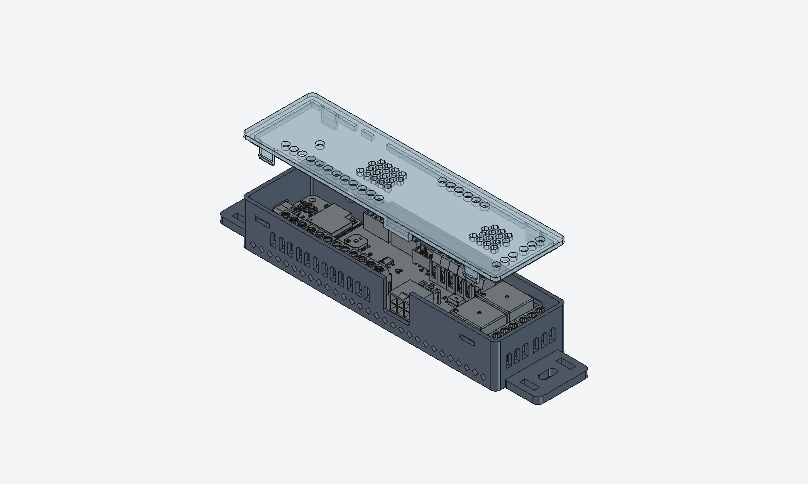

# WROOM-1U MDB slave enclosure: clips only

PETG enclosure for the `mdb_slave_esp32s3-wroom-1u` board. The lid is held by
4 clips only: no lid screws, no external bosses, narrower body.
For a version with optional lid screws, see [`../screw-clips`](../screw-clips).



## Printed result

| Parts before assembly | Board screwed in the base | Closed |
|:---:|:---:|:---:|
|  |  |  |

## Files

| File | Content |
|------|---------|
| `base.stl` / `base.step` | Base with board standoffs and mounting ears |
| `lid.stl` / `lid.step` | Lid. The STL is flipped: outer face on the bed, clips up |
| `build_case.py` | Parametric FreeCAD source for both parts |
| `case_wroom-u1-clips.3mf` | Slicer project (base + lid) |

## Dimensions

- Base: 195 × 43.5 × 26 mm (mounting ears included).
- Closed height: 28 mm.
- Board bottom sits 7 mm above the bottom of the base.

## Openings

- **USB-C:** 12.8 × 7.2 mm window in the west wall, flush with the connector, with
  45° chamfers above it so the top bridge is only 6.8 mm.
- **MDB (Mini-Fit 2×3):** 15.6 mm wide window in the south wall, open up to the rim.
  A tab on the lid closes it 2 mm above the header, which leaves room for the plug latch.
- **Terminal blocks:** one 4.0 × 7.4 mm wire window with a round top per pole (30 poles on the south,
  north and east walls), plus a Ø4 hole in the lid above each terminal screw. The poles
  sit 5.08 mm apart, so 4.0 mm leaves 1.08 mm webs between neighbouring openings: two
  lines with a 0.4 mm nozzle (`TERM_W` in the script).
- **LED D0 (WS2812B):** Ø4 hole in the lid.
- **Antenna:** 3 × 2 mm slot at the top of the north wall, under the lid, close to the
  ESP32 U.FL connector.
- **UART debug:** 8 × 2 mm slot at the top of the north wall, under the lid, above
  the J1 header (EN/TXD/RXD/IO0). Lets debug wires out with the lid closed.
- **Ventilation:** 1.6 × 3.4 mm slots with a pointed 45° top below the board in the long walls, and
  1.6 × 12 mm slots in the lid above the relays and the centre area. Air flows in at
  the bottom and out at the top.

## Closing

4 tabs (8 × 1.2 mm, 0.8 mm catch), one near each corner, snap into 1.2 mm deep blind
notches in the inner face of the north and south walls; the outside of the wall stays
closed. Press the lid down to close. To open, flex the long walls outwards and lift
the lid.

## Mounting

Two 4 mm thick ears. Each has a 10 × 4.5 mm slot for an M4 screw and two 9 × 3.2 mm
zip-tie slots. The ears are solid underneath and sit flat on the print bed, so the
screw clamps solid plastic.

## Hardware

- 4 heat inserts M2.5 × 5 × Ø3.5 for the board.
- Insert bore: Ø3.3 × 5.6 mm with a lead-in chamfer. Validated on a test coupon:
  3.3 mm fits, 3.4 mm is too loose. Change `INSERT_BORE` if your inserts differ.
- 4 M2.5 × 6 screws for the board.

## Printing

Starting point:
- PETG, 0.4 mm nozzle, 0.2 mm layers, 3 perimeters, 20 % infill, no supports.
- No web between two openings is thinner than 1 mm, so nothing drops out at 0.4 mm.
- Base flat on its bottom face. Lid as exported: outer face on the bed.
- The wall windows have 45° or round tops, so they need no supports. The longest bridge is
  6.8 mm, above USB-C. Check it in the slicer preview.

## Regenerating

Edit the parameters at the top of `build_case.py`, then run from this folder:

```bash
"C:\Program Files\FreeCAD 1.1\bin\freecadcmd.exe" build_case.py
```

The script reads the board model from [`../pcb_wroom-u1.step`](../pcb_wroom-u1.step)
(STEP export of `kicad/mdb_slave_esp32s3-wroom-1u`). It rewrites the STEP and STL files
and prints geometry checks: solid validity, base/lid overlap and collisions with the
board. `LID_SCREWS = True` in the script produces the screw-clips variant.

## Limitations

- The collision check covers the geometry in the board STEP only. Mating plugs,
  cables and tools are not modelled.
- The WS2812B LED has no 3D model in the STEP. Its position comes from the
  `.kicad_pcb` file.
- The RST and BOOT buttons are only reachable with the lid off.
- Without screws, a strong shock or vibration can pop the lid off. Test clip
  retention in place, and tune `BUMP` and `CLIP_T` if needed.
